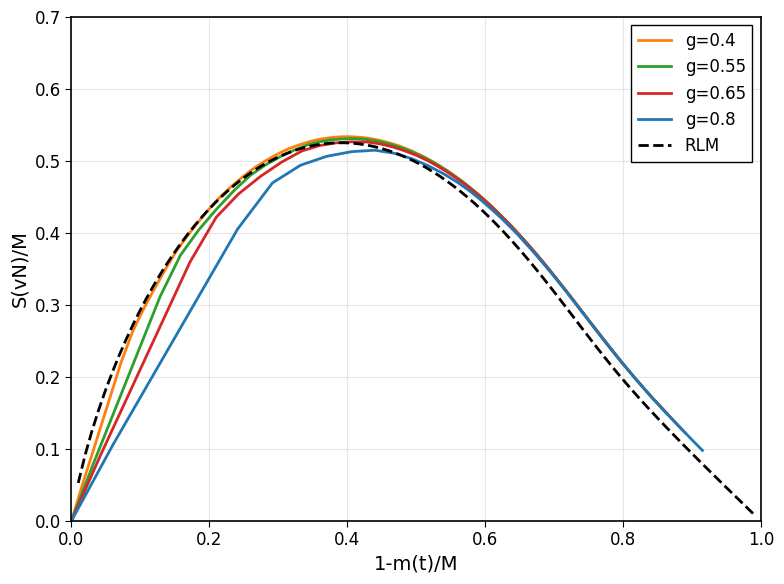

# Page Curve Like Entanglement Dynamics in Many-Body Quantum Systems: A Study of a Free Fermionic Model

**Undergraduate thesis (B.Sc. in Physics)** · Prosanto Bhakta
Department of Physical Sciences, Independent University, Bangladesh (IUB)
Supervisor: Prof. M. Arshad Momen · Defended February 2026

📄 [Thesis (PDF)](thesis.pdf) · 🎤 [Defence slides (PDF)](slides.pdf)

## Abstract

This thesis investigates entanglement dynamics in open quantum many-body systems, focusing on a one-dimensional free-fermion model in which a finite system is coupled to a large environment. We study the model introduced by S. Kehrein, [Phys. Rev. B **109**, 224308 (2024)](https://doi.org/10.1103/PhysRevB.109.224308), which becomes exactly solvable in the weak-coupling limit. Using resonant-level-model factorization, we derive analytical expressions for the entanglement dynamics and validate them with numerical simulations based on the correlation matrix formalism. We show that the system exhibits Page-curve-like behavior: the entanglement entropy grows at early times, reaches a maximum at the Page time (proportional to system size), and then decreases at late times. In the appropriate scaling regime, data for different system sizes collapse onto a single curve when plotted against the emitted-particle fraction.

## Key results

<p align="center">
  
</p>

- **Page-curve-like dynamics:** linear entropy growth, a maximum at a Page time $t_P \propto M$, then decay.
- **Maximum entropy** $S_{\max} \approx 0.52\,M$, below the $M \ln 2 \approx 0.69\,M$ bound, because free-fermion (Gaussian) dynamics are not fully ergodic.
- **Universal scaling collapse** across system sizes when entropy is plotted against the emitted-particle fraction $1 - m(t)/M$.
- **Information vs. observables:** the particle number shows no feature at the Page time; the Page curve shows up in quantum information, not in local observables.

## Method

- **Model:** a finite tight-binding chain of $M$ sites (system) coupled with strength $g$ to a much larger chain of $N$ sites (environment), following Kehrein (2024).
- **Analytics:** in the weak-coupling limit the problem factorizes into independent resonant level models (Born–Markov and secular approximations, surface Green's function of a semi-infinite chain).
- **Numerics:** exact time evolution of the single-particle correlation matrix; entanglement entropy from its eigenvalues (Peschel's method), for $M = 20$–$70$ and $N$ up to $10^4$.

## Repository contents

| Path | Description |
|---|---|
| [`thesis.pdf`](thesis.pdf) | Full thesis |
| [`slides.pdf`](slides.pdf) | Thesis defence slides |
| [`notebooks/fermionic_entanglement.ipynb`](notebooks/fermionic_entanglement.ipynb) | Simulation (`PageCurveSimulation`), analytical predictions (`AnalyticalPageCurve`) and plotting (`PageCurveAnalysis`) |
| [`scripts/page_curve_schematic.py`](scripts/page_curve_schematic.py) | Generates the conceptual Page-curve schematic |
| [`latex/`](latex/) | LaTeX source of the thesis and slides, with figures |

## Reproducing the results

```bash
git clone https://github.com/Proshant45/undergraduate-thesis.git
cd undergraduate-thesis
python -m venv .venv && source .venv/bin/activate
pip install -r requirements.txt
jupyter notebook notebooks/fermionic_entanglement.ipynb
```

Run the class-definition cells first, then call the plotting methods of `PageCurveAnalysis`:

| Thesis figure | Method | Default parameters |
|---|---|---|
| Fig. 3: particle decay for different $M$ | `PageCurveAnalysis.plot_particle_decay_for_different_M()` | $M \in \{20, 30, 50, 70\},\ N = 10^4,\ g = 0.5,\ t_{\mathrm{sys}} = 1,\ t_{\mathrm{env}} = 4$ |
| Fig. 4: Page curve for different $M$ | `PageCurveAnalysis.von_neumann_entropy_for_different_M()` | $M \in \{20, 30, 50, 70\},\ N = 10^4,\ g = 0.5,\ t_{\mathrm{sys}} = 1,\ t_{\mathrm{env}} = 4$ |
| Fig. 5: entropy vs. emitted fraction for different $g$ | `PageCurveAnalysis.von_neumann_entropy_for_different_g()` | $g \in \{0.4, 0.55, 0.65, 0.8\},\ M = 50,\ N = 500,\ t_{\mathrm{sys}} = 1,\ t_{\mathrm{env}} = 5$ |
| Fig. 6: finite-environment effects | `PageCurveAnalysis.von_neumann_entropy_for_different_N()` | $N \in \{75, 100, 200, 300, 10^4\},\ M = 50,\ g = 0.65,\ t_{\mathrm{sys}} = t_{\mathrm{env}} = 1$ |

> **Note:** Each plotting method defaults to the exact parameters used in the thesis figures and embeds the corresponding output plot in the notebook. Because $N = 10^4$ diagonalizes a dense $(M+N)\times(M+N)$ Hamiltonian and takes significant RAM and runtime, you can pass a smaller bath size (e.g. `N=1000`) as a keyword argument for a quick run on a laptop.

### Building the PDFs

```bash
cd latex
latexmk -pdf main.tex          # thesis
latexmk -pdf presentation.tex  # slides
```

## Citation

```bibtex
@thesis{Bhakta2026PageCurve,
  author = {Bhakta, Prosanto},
  title  = {Page Curve Like Entanglement Dynamics in Many-Body Quantum Systems: A Study of a Free Fermionic Model},
  school = {Independent University, Bangladesh},
  type   = {B.Sc. thesis},
  year   = {2026},
  url    = {https://github.com/Proshant45/undergraduate-thesis}
}
```

## License

Code (notebooks and scripts) is released under the [MIT License](LICENSE). The thesis text, slides and figures are licensed under [CC BY 4.0](https://creativecommons.org/licenses/by/4.0/).
